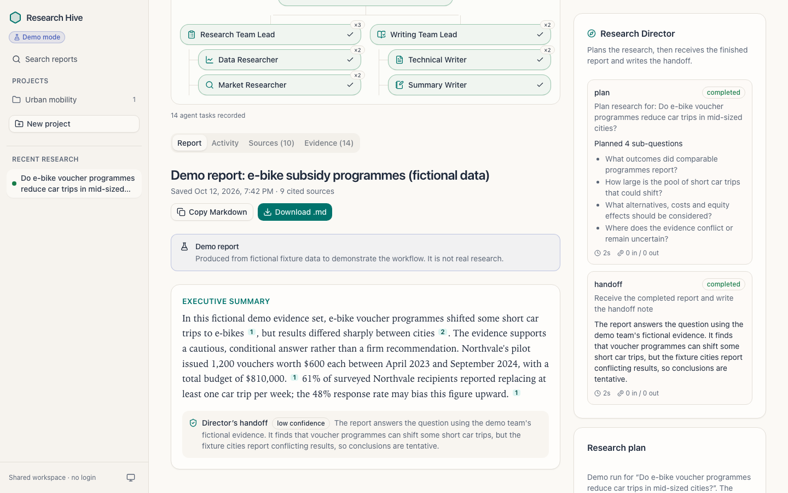

# Research Hive

A hierarchical multi-agent research platform. Ask a question; a small team of
AI agents plans the research, gathers real sources from the web, reviews the
evidence and writes a readable report in which every key claim cites a
numbered source. Runs, evidence and reports are saved in PostgreSQL.



* **Seven fixed roles**: Research Director → Research Team Lead (Data and
  Market Researchers) and Writing Team Lead (Technical and Summary Writers),
  orchestrated by an explicit LangGraph workflow with bounded loops.
* **Evidence you can check**: verbatim excerpts verified against the stored
  source text, snippet-only sources labelled as such, citations validated and
  renumbered in code, partial reports clearly marked.
* **Guardrails in code**: SSRF-safe page retrieval, role-based tool
  permissions, shared budgets and deadlines, cancellation, and a single
  durable worker.
* **Calm UI**: live progress over SSE, an HTML/CSS agent hierarchy, sources and
  evidence tabs, citation previews, Markdown copy/download, saved-report
  search, light and dark themes.
* **Demo mode**: runs completely offline on clearly fictional fixtures, with no
  API keys and no external calls.

Saved reports also offer **Download PDF**: a paginated A4 document with the
summary, findings, analysis, limitations and clickable source references.
PDF export uses ReportLab and the saved report content, retains demo/partial
notices, and makes no additional model or web calls. Markdown download and
copy remain available. After updating the project, run `uv sync` in `backend/`
and rebuild the frontend with `npm run build` to enable the new option.

> **Costs.** The application is open source, but the services it uses are
> not free: OpenAI (or Anthropic) API calls are billed per token, Tavily
> searches are billed per request beyond the free monthly credits, and managed
> PostgreSQL (e.g. Aiven) or hosting is billed by its provider. Demo mode makes
> no paid calls.

> **Access.** There is no login. Everyone who can reach the server shares one
> workspace. It binds to `127.0.0.1` by default; read
> [docs/security.md](docs/security.md) before exposing it on a network.

## Requirements

* Python 3.12+ and [uv](https://docs.astral.sh/uv/)
* Node.js 20.19+ (22 LTS recommended) and npm
* PostgreSQL 14+ (Aiven or local) — the app needs one database it can create a
  schema in
* Live mode only: an [OpenAI API key](https://platform.openai.com/api-keys)
  (or an Anthropic key) and a [Tavily API key](https://app.tavily.com/)

## Technology stack

* **Frontend:** React 19 and TypeScript, built with Vite. React Router handles
  pages; TanStack Query loads and refreshes server data. Tailwind CSS 4 and
  shadcn/ui components built on Radix provide the interface. React Markdown
  renders the validated reports, and SSE delivers live run progress.
* **Backend:** Python 3.12+, FastAPI and Uvicorn provide the async API and
  serve the compiled frontend. Pydantic validates configuration, requests
  and agent outputs; structlog produces redacted JSON logs.
* **Agent orchestration:** LangGraph runs an explicit seven-role workflow.
  OpenAI or Anthropic generates structured outputs, Tavily searches the web,
  and HTTPX with BeautifulSoup/lxml retrieves and extracts source text.
* **Persistence:** PostgreSQL stores projects, runs, tasks, evidence, reports
  and events. SQLAlchemy uses Psycopg 3 for connections; Alembic manages
  schema migrations. The database also supplies the durable queue and worker
  lock, so Redis and Celery are not needed.
* **Development checks:** uv manages Python dependencies; npm manages the
  frontend. Ruff, mypy and pytest check the backend; TypeScript, oxlint,
  Vitest and Playwright check the frontend.

## From question to report

1. Create a project, enter a question and optional context/reference URLs,
   and choose Quick or Standard depth.
2. The API saves a queued run in PostgreSQL. The background worker claims
   it and starts the LangGraph workflow.
3. The director plans the research. The research lead assigns complementary
   tasks to the data and market researchers, which work in parallel.
4. Researchers collect sources and verified excerpts. Their lead reviews
   the findings and can request a bounded extra research pass.
5. The writing lead outlines the report from approved evidence. The technical
   writer drafts it, the lead reviews it, and the summary writer summarizes
   the resulting report.
6. Code validates and renumbers citations; the director adds a handoff note.
   The backend saves the report and its source links. The UI receives progress
   events throughout and lets you inspect evidence or download Markdown.

See [Architecture](docs/architecture.md) for the exact graph, backend layers
and how the agents exchange structured results.

## Quick start (demo mode)

```bash
git clone git@github.com:mlbala/hierarchical-research-agents.git
cd hierarchical-research-agents
cp .env.example .env            # DEMO_MODE=true by default; set the PG* values

# Backend dependencies + database schema
cd backend
uv sync
uv run python ../scripts/bootstrap_db.py     # checks TLS/connection, creates schema, migrates

# Frontend build (served by FastAPI)
cd ../frontend
npm ci
npm run build

# Run
cd ../backend
uv run python -m app            # open http://127.0.0.1:8000
```

Create a project, ask a question (the demo fixtures are about e-bike subsidy
programmes) and watch the agents work. Demo reports are labelled as fictional.

Demo mode still requires PostgreSQL: it replaces LLM/search/page-fetch calls
with fixtures, while persistence and the worker run normally.

### Database setup and connection checks

Set `PGDATABASE` to the exact name of an existing database, and `DB_SCHEMA`
to the namespace for this application's tables (default `research_hive`).
The database and schema are different objects: successfully connecting or
running `SELECT VERSION()` does not create the application tables.

```bash
# From the repository root, after uv sync in backend/
backend/.venv/bin/python scripts/bootstrap_db.py --check  # read-only status
backend/.venv/bin/python scripts/bootstrap_db.py          # create schema + migrate
```

`--check` exits with status 1 when migrations are missing or behind; it does
not initialize them. If it reports `Connected` followed by `Schema ... missing`,
connectivity works: run the command without `--check`. The bootstrap script
creates the configured schema and applies migrations, but never creates the
database or database roles. Its user must have permission to create the schema.

This project reads `PGHOST`, `PGPORT`, `PGDATABASE`, `PGUSER`, `PGPASSWORD`,
`PGSSLMODE` and `PGSSLROOTCERT`. Older applications' `DB_HOST`, `DB_NAME`,
`DB_USER`, `DB_PASSWORD` and `DATABASE_URL` settings are not supported aliases.
Relative CA paths are resolved from the repository root. Restart the backend
after changing `.env`. See [Aiven setup](docs/aiven.md) for remote TLS setup.

## Live mode

OpenAI is the default provider. Set in `.env`:

```ini
DEMO_MODE=false
LLM_PROVIDER=openai
OPENAI_API_KEY=sk-...
OPENAI_MODEL=gpt-6-luna            # cheapest current-generation OpenAI model
OPENAI_REASONING_EFFORT=low        # none|low|medium|high|xhigh|max; lower = cheaper
TAVILY_API_KEY=tvly-...
LLM_INPUT_USD_PER_MTOK=0.10        # gpt-6-luna prices, for the cost estimate
LLM_OUTPUT_USD_PER_MTOK=0.50
```

A Standard run uses roughly 65k input and 15–40k output tokens. Prices from
OpenAI's pricing page (checked 2026-10-12), per million input / output tokens:

| Model | Price | ≈ cost per Standard run | Notes |
| --- | --- | --- | --- |
| `gpt-6-luna` (default) | $0.10 / $0.50 | ~$0.01–0.03 | latest generation, built for high-volume focused tasks |
| `gpt-5-nano` | $0.05 / $0.40 | ~$0.01–0.02 | slightly cheaper, older; OpenAI retires it on 2026-12-11 |
| `gpt-5.6-luna` | $0.20 / $1.20 | ~$0.02–0.06 | older and pricier than `gpt-6-luna` |
| `gpt-5-mini` | $0.25 / $2.00 | ~$0.05–0.10 | not cheaper |
| `gpt-6.1-sol` | $2 / $10 | ~$0.30–0.55 | best writing, highest cost |

When you change the model, update the two price settings too.

Anthropic remains supported: set `LLM_PROVIDER=anthropic`,
`ANTHROPIC_API_KEY` and `ANTHROPIC_MODEL` (e.g. `claude-haiku-5-5` for low cost
or `claude-opus-5-5` for the highest quality); `ANTHROPIC_EFFORT` and
`ANTHROPIC_REFUSAL_FALLBACK` are optional.

Live mode fails clearly (UI warning, `503 CONFIGURATION_ERROR` on run
creation, readiness check) when a key or the model is missing, and a run stops
with `LLM_QUOTA_EXCEEDED` when the provider account runs out of credit.
Without both price settings the estimated cost is shown as "unknown".

## Development

### Installing with pip

Python 3.12+ users can install the locked backend dependencies without uv:

```bash
cd backend
python3 -m venv .venv
source .venv/bin/activate
python -m pip install --require-hashes -r requirements.txt
# For lint, type checks and tests, install requirements-dev.txt instead:
# python -m pip install --require-hashes -r requirements-dev.txt
python ../scripts/bootstrap_db.py
python -m app
```

Both files include pinned transitive dependencies and package hashes;
`requirements-dev.txt` includes runtime dependencies plus development tools.
`pyproject.toml` and `uv.lock` remain the source of truth. Regenerate the files
after dependency changes, from `backend/`:

```bash
uv export --frozen --no-dev --no-emit-project --output-file requirements.txt
uv export --frozen --no-emit-project --output-file requirements-dev.txt
```

Frontend dependencies still use `npm ci` in `frontend/`.

Run the backend and the Vite dev server side by side; Vite proxies `/api`
(including SSE) to the backend:

```bash
cd backend  && uv run python -m app --reload   # http://127.0.0.1:8000
cd frontend && npm run dev                      # http://localhost:5173
```

Run these in separate terminals after installing dependencies and applying
the database migrations. For a single-server setup, build the frontend and
run only the backend as shown in Quick start. Check readiness with:

```bash
curl http://127.0.0.1:8000/api/v1/health/ready
```

Readiness checks database access, migrations, provider configuration and worker
state without making paid provider calls.

Checks and tests (details in [docs/testing.md](docs/testing.md)):

```bash
./scripts/check.sh      # ruff, mypy, pytest, tsc, oxlint, vitest, build, Playwright
```

Database tests and the Playwright suite need a dedicated test database
configured via `TEST_PG*` variables (name must end in `_test`).

## Configuration

All settings are environment variables (see [.env.example](.env.example)).
The essentials:

| Variable | Default | Purpose |
| --- | --- | --- |
| `HOST`, `PORT` | `127.0.0.1`, `8000` | bind address |
| `APP_ORIGIN`, `ALLOWED_HOSTS` | Vite origin, `localhost,127.0.0.1` | browser origin and Host allowlists |
| `DEMO_MODE` | `true` | offline fixtures vs. live providers |
| `PGHOST` … `PGSSLROOTCERT` | — | PostgreSQL connection (structured parameters, `verify-full` TLS) |
| `DB_SCHEMA` | `research_hive` | all tables live in this schema |
| `DB_POOL_SIZE`, `DB_MAX_OVERFLOW` | `3`, `2` | small pool for a small managed database |
| `LLM_PROVIDER` | `openai` | `openai` or `anthropic` |
| `OPENAI_API_KEY`, `OPENAI_MODEL`, `OPENAI_REASONING_EFFORT` | —, `gpt-6-luna` in template, `low` | OpenAI live provider |
| `ANTHROPIC_API_KEY`, `ANTHROPIC_MODEL` | — | Anthropic live provider |
| `TAVILY_API_KEY` | — | live web search |
| `MAX_*`, `RUN_TIMEOUT_SECONDS` | see [operations](docs/operations.md) | per-run budgets and limits |

## Documentation

* [Architecture](docs/architecture.md) — system diagram, agent responsibilities, workflow, evidence pipeline
* [Database](docs/database.md) — schema, tables, constraints, migrations, least-privilege roles, pgvector notes
* [Aiven setup](docs/aiven.md) — connection details, CA certificate, database creation
* [Security](docs/security.md) — threat model, guardrails, private-network deployment, limitations
* [Operations](docs/operations.md) — running, health checks, limits, restarts, logging, costs
* [Testing](docs/testing.md) — test database setup and coverage

## Project layout

```
backend/    FastAPI app (app/), Alembic migrations, pytest suite
frontend/   React + TypeScript + Vite + Tailwind + shadcn/ui, Vitest, Playwright
scripts/    bootstrap_db.py (schema + migrations), check.sh (all quality gates)
docs/       architecture, database, Aiven, security, operations, testing
```

## License

[MIT](LICENSE)
