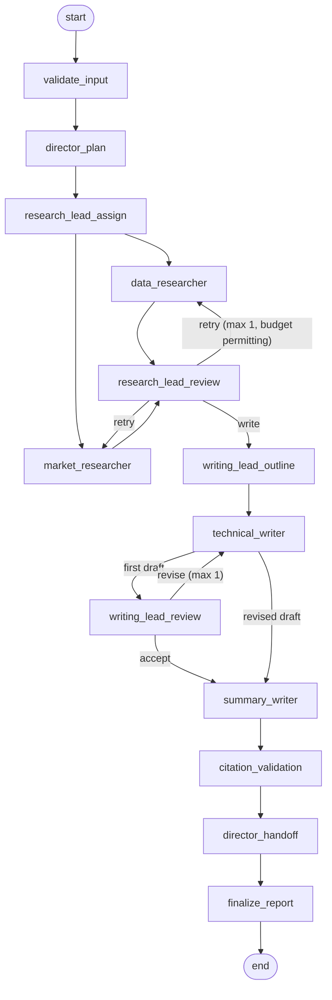
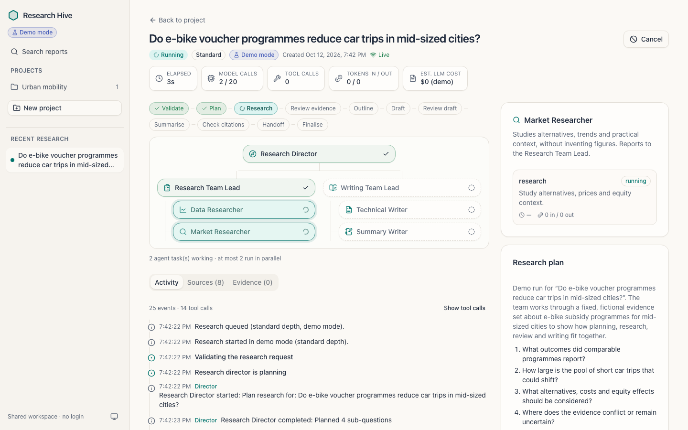

# Architecture

Research Hive is one FastAPI backend process and one React frontend. The
backend serves the REST API, the Server-Sent Events (SSE) progress streams and
the built frontend, and runs a single managed background worker that executes
research runs with LangGraph. PostgreSQL holds all state.

## System overview

```
 Browser (React + TanStack Query)
   │  REST /api/v1/*  (JSON + X-Research-Hive header on mutations)
   │  SSE  /api/v1/runs/{id}/events/stream   (replays from Last-Event-ID)
   ▼
 FastAPI process (uvicorn, 1 worker, 127.0.0.1 by default)
   ├── SecurityMiddleware: request IDs, Host allowlist, Origin/CSRF guard,
   │                       security headers, single-point error handling
   ├── API routers ──────────────► services (projects, runs, reports, events)
   ├── Static frontend (frontend/dist, same origin)
   └── ResearchWorker (one asyncio loop, advisory-lock leader)
         │ claims queued runs atomically (FOR UPDATE SKIP LOCKED)
         ▼
       LangGraph StateGraph  ──► RunContext (budgets, deadline, cancellation,
         │                         retries, task bookkeeping, events)
         ├── LLM adapter ─────────► Anthropic Messages API (live) | DemoLLM
         ├── web_search ──────────► Tavily REST API (live)       | DemoSearch
         ├── fetch_page ──────────► SSRF-safe fetcher (live)     | DemoPageFetcher
         └── run_evidence ────────► PostgreSQL (run-scoped)
                                         ▲
 PostgreSQL (research_hive schema) ──────┘  projects, research_runs, agent_tasks,
                                            sources, findings, reports,
                                            report_citations, run_events
```

Why this shape:

* **One process, one worker loop.** Small, single-user deployments do not need
  Redis, Celery or separate services. Runs are queued in PostgreSQL, so they
  survive restarts; the worker is not a request-scoped background task.
* **Single executor guarantee.** The worker only executes runs while it holds
  a PostgreSQL session advisory lock on a dedicated connection. Extra
  processes stay in standby. Runs are claimed with an atomic
  `UPDATE … WHERE id = (SELECT … FOR UPDATE SKIP LOCKED)`.
* **Short transactions.** Every database write opens and commits its own
  short transaction. No transaction is held across an LLM or network call.

## Agent hierarchy

```
Research Director
├── Research Team Lead
│   ├── Data Researcher
│   └── Market Researcher
└── Writing Team Lead
    ├── Technical Writer
    └── Summary Writer
```

| Role | Responsibility | Tools it may use |
| --- | --- | --- |
| Research Director | Turns the question into a bounded plan (objective, ≤5 sub-questions, data and context focus). After writing, receives the finished report and writes the handoff note (confidence and caveats). | run evidence |
| Research Team Lead | Assigns objectives and concrete search queries to the researchers; reviews every finding (supported / weak / unsupported / conflicting), notes contradictions and gaps; may request **one** extra research pass. | run evidence |
| Data Researcher | Facts, statistics, dates and primary sources; reads user reference URLs first; each finding has a verbatim excerpt and an estimate flag. | web search, page fetch, run evidence |
| Market Researcher | Alternatives, competitors, trends or practical context (non-commercial questions); never invents figures. | web search, page fetch, run evidence |
| Writing Team Lead | Outlines the report from approved findings; reviews the draft for clarity and evidence coverage; may request **one** revision. | run evidence |
| Technical Writer | Writes the detailed report with numbered citations, labelling inference, uncertainty and conflicts. | run evidence |
| Summary Writer | Writes the executive summary from the actual report, adding no new claims. | run evidence |

Workers report to their team lead and team leads report to the director: each
`agent_tasks` row records `parent_task_id`, and the tests assert the chain.
The roles, parents and tool permissions are constants in
`backend/app/agents/roles.py`; agents cannot create agents or tools, change
limits or system instructions, or choose arbitrary next nodes.

## Workflow



* The two researchers run in the same LangGraph super-step (in parallel), at
  most `MAX_PARALLEL_AGENT_TASKS` agent tasks at a time.
* Every conditional edge has an explicit path map. Routing functions only read
  decisions computed in code from limits and budgets: a retry pass is taken
  only if the lead asked for it **and** `research_retries` allows it **and**
  enough LLM calls remain for the writing phase. A revision is taken only if
  the lead did not approve **and** `writing_revisions` and the budget allow.
  `recursion_limit` is a further hard stop.
* If no usable evidence exists after review, the run fails with
  `NO_USABLE_EVIDENCE`; nothing is written from model memory.
* If some evidence is usable but coverage is incomplete (researcher failure,
  limits hit, uncovered sub-questions, unresolved writing issues), the report
  is saved with `is_partial = true` and the reasons appear in its limitations.

## Evidence and citations

1. Researchers search, then read pages with the SSRF-safe fetcher. A page that
   cannot be read is kept only as a **search snippet** (`content_kind =
   search_snippet`) and is never presented as read; snippet evidence is capped
   at `tentative`.
2. Sources are de-duplicated per run by a normalised-URL hash.
3. The model extracts findings using run-local handles (`S1`, `S2`). Code maps
   handles to source IDs and **verifies each excerpt verbatim** against the
   stored source text; unverifiable findings are discarded with a warning.
4. The research lead judges whether each excerpt actually supports its claim;
   unsupported findings are excluded from writing, weak ones downgraded.
5. Writers cite provisional numbers from a code-built source list.
6. `citation_validation` removes unknown markers, renumbers citations `[1]..[n]`
   by first appearance, rejects summary citations absent from the body, flags
   summary figures missing from the body, and checks run ownership of every
   cited source in the database before anything is saved.
7. The report structure (headings, key findings list, sources list) is
   assembled by code; model prose is sanitised (no raw HTML, images or unsafe
   links).

## Live progress



Every user-visible event is inserted into `run_events` before it is announced
in-process. The SSE endpoint reads from the database after the client's
`Last-Event-ID` (or `?after=`), so replay is ordered and survives reconnects
and server restarts; it sends heartbeats and ends after a terminal status.
Closing the browser never cancels a run. Console logs (structlog JSON) are
separate from these user-visible events.

## Code map

```
backend/app/
  main.py            app factory, lifespan, middleware, static frontend
  core/              settings, errors + envelope, logging/redaction, retry,
                     security middleware, Markdown hardening
  db/                engine/sessions (structured params, TLS), ORM models
  agents/            roles, prompts, LLM adapter, demo LLM, run context,
                     graph nodes, graph definition
  tools/             URL safety, fetcher, extraction, Tavily, demo fixtures,
                     tool registry (permissions)
  services/          runs, events, evidence, citations, reports, budget,
                     readiness, worker
  api/               REST + SSE routers
backend/migrations/  Alembic (schema-aware, version table in research_hive)
frontend/src/        pages, components (shadcn/ui), hooks, lib
scripts/             bootstrap_db.py, check.sh
```
